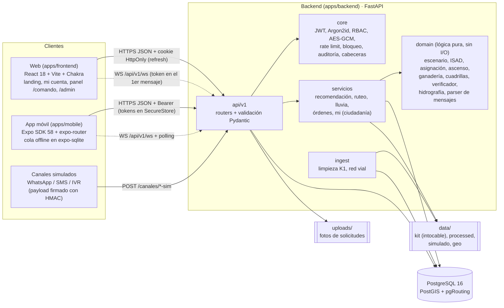

# Arquitectura · Plataforma de Gestión de Evacuaciones

> PROTOTIPO · AI LAB Misión: Código Formosa · no es una herramienta oficial

Monorepo con tres aplicaciones y un paquete compartido. El backend concentra la lógica y los datos; la web y la app móvil son clientes del mismo contrato REST + WebSocket (`docs/contrato_api.md`, `docs/openapi.json`).

## Vista general



## Módulos

### Backend (`apps/backend/app`)

| Capa | Contenido | Regla |
|---|---|---|
| `api/v1` | `meta`, `auth`, `usuarios`, `datos`, `simulacion` (con `ruteo`), `lluvia`, `canales`, `operacion`, `solicitudes`, `mi`, `centinela`, `ws`, más `esquemas` | Solo transporte: valida entradas (Pydantic v2, `extra="forbid"`), aplica RBAC y delega. Errores con el sobre común `{error: {codigo, mensaje, detalle}}`. |
| `domain` | `escenario`, `isad`, `asignacion`, `ascenso`, `ganaderia`, `cuadrillas`, `verificador`, `hidrografia`, `ruteo`, `parser_mensajes` | Lógica pura sin I/O: funciones de entrada y salida, probadas sin base de datos. Los supuestos salen de `config/supuestos.yaml`. |
| `servicios` | `contexto`, `recomendacion`, `ruteo`, `lluvia`, `ordenes`, `mi`, `capas` | Orquestan dominio + base (consultas espaciales, `pgr_dijkstra`, planilla UPCA). |
| `core` | `seguridad` (Argon2id, JWT), `sesiones` (refresh rotativo), `bloqueo`, `limitador`, `rbac`, `cifrado` (AES-GCM), `auditoria` (hash encadenado), `cabeceras`, `eventos` (difusión WebSocket), `datos_personales` | Todas las medidas de `docs/seguridad.md`. |
| `db` | `modelos` (SQLAlchemy 2 + GeoAlchemy2, 26 tablas), `sesion`, `consultas`, `seed` (idempotente) | El esquema lo crea Alembic (`alembic/versions/0001` a `0003`). |
| `ingest` | `limpieza_k1`, `red_vial` | Producen `data/processed/` y cargan la red para pgRouting; no tocan `data/kit/`. |
| `config` | `settings` (variables de entorno), `supuestos.yaml` | Todo número que sea un supuesto vive en el YAML con su fuente o la palabra `SUPUESTO`. |

### Web (`apps/frontend/src`)

| Carpeta | Contenido |
|---|---|
| `landing`, `pages/Landing` | Hero 3D (React Three Fiber, carga diferida) con alternativa 2D en SVG si no hay WebGL o el usuario pide menos movimiento; escala hidrométrica; selector de perfil |
| `pages`, `informacion` | Páginas públicas y por perfil: Información (El Niño, serie K1, mapa de sectores), registros, login, mi cuenta, admin |
| `panel` | Panel operativo `/comando/*`: monitor, mapa (MapLibre + Deck.gl, carga diferida), simulador, recomendador, producción, operación, lluvia, órdenes, bitácora, Centinela, límites |
| `auth`, `lib` | Contexto de sesión (access token solo en memoria), rutas protegidas por rol, cliente de API, WebSocket, validación de formularios |
| `datos` | JSON estático derivado del kit (serie diaria K1, sectores K10) como respaldo cuando el backend no responde |

### App móvil (`apps/mobile/src`)

| Carpeta | Contenido |
|---|---|
| `app` | Rutas de expo-router: bienvenida, login, registro y grupo `(app)` (inicio, perfil, asistencia, solicitudes, alertas, sector, cuadrilla) |
| `lib` | Sesión con refresh rotativo, cliente de API, cola offline (`cola`, `colaSqlite`), tiempo real y notificaciones locales, codificador SOS-FSA |
| `components` | Leyenda fija en toda pantalla, mapa del sector, formularios |

### `packages/shared`

Constantes comunes a web y app: leyenda obligatoria, categorías de dato, roles y fecha de corte.

## Flujo de datos

1. **Datos del kit.** `data/kit/` (K1, K3, K10, planilla) no se modifica. `python -m app.ingest.limpieza_k1` genera `data/processed/` y `docs/registro_limpieza.md`; `python -m app.db.seed` carga K3, K10 sin cambios, K1 limpio y los datos simulados de `data/simulado/` en PostgreSQL.
2. **Simulación.** El operador mueve la altura de Puerto Formosa, la lluvia y los caminos cerrados en el panel. La web llama a `POST /simulacion/escenario`; el dominio calcula el estado de cada sector, de los accesos y del río contra los umbrales K3. El recomendador (`/simulacion/recomendacion`) suma la población de K10 y la registrada dentro de cada polígono y asigna centros por prioridad y capacidad; el ruteo usa pgRouting sobre la red OSM, con alternativa por distancia si no hay red. Todo se rotula `SIMULADO`.
3. **Decisión.** Solo el rol `decisor` emite una orden (`POST /ordenes`). La orden crea notificaciones para los usuarios del sector, tareas para las cuadrillas y un borrador de bitácora K8 que el decisor completa; se emite un evento por WebSocket.
4. **Ciudadanía y productores.** Se registran en la web o la app con consentimiento (Ley 25.326). Un pedido de asistencia se encola en el teléfono (`expo-sqlite`), se envía en dos tiempos (JSON con `Idempotency-Key` y luego la foto) y aparece en `/comando/operacion`. Las órdenes llegan como notificación local.
5. **Lluvia.** Partes por formulario, planilla UPCA o canal simulado pasan por el parser y la validación; el origen queda siempre visible (celda vacía = sin medición, distinta de 0).
6. **Centinela.** Los verificadores K6 y K7 calculan su evidencia contra K1, K3 y la capa de cursos de agua del IGN; la bitácora K8 queda exportable a Markdown.

## Fronteras de seguridad

```
 Internet / dispositivo        Frontera 1: TLS + CORS acotado + cabeceras        Backend
 ──────────────────────  ─────────────────────────────────────────────────  ────────────────
 Web (token en memoria,        Frontera 2: autenticación (JWT 15 min,           RBAC por endpoint
 refresh en cookie HttpOnly)   refresh rotativo con detección de reutilización)  y por recurso
 App (SecureStore)             Frontera 3: rate limit + bloqueo por cuenta/IP    Datos sensibles
 Canales simulados             Frontera 4: firma HMAC X-Hub-Signature-256        cifrados (AES-GCM)
 WebSocket                     Frontera 5: token en el primer mensaje (5 s)      Auditoría con
                                                                                 hash encadenado
```

- El navegador y el teléfono no son de confianza: el ocultamiento de pantallas por rol es solo comodidad; la autorización real está en el backend.
- Los secretos (`JWT_SECRET`, `FIELD_ENCRYPTION_KEY`, `CANAL_HMAC_SECRET`, contraseñas de demo) solo existen como variables de entorno; el backend se niega a firmar o cifrar si faltan.
- La base de datos solo es accesible desde el backend; las fotos se guardan en `uploads/`, fuera de `data/`, con nombre generado por el servidor.
- Detalle, mapeo a OWASP Top 10 y límites conocidos en `docs/seguridad.md`.

## Despliegue de la demo

`docker-compose.yml` levanta `db` (imagen `pgrouting/pgrouting:16-3.4-3.6.1`, con PostGIS y pgRouting) y `backend` (Python 3.12; aplica `alembic upgrade head` y `python -m app.db.seed` antes de arrancar Uvicorn; monta `./data` en `/data` en solo lectura). La web (Vite) y la app (Expo) corren en la máquina del desarrollador. No hay despliegue productivo (CLAUDE.md §15).

## Decisiones relacionadas

`docs/decisiones.md` (P1 a P12 y decisiones técnicas), `CLAUDE.md` §1 y §16.
